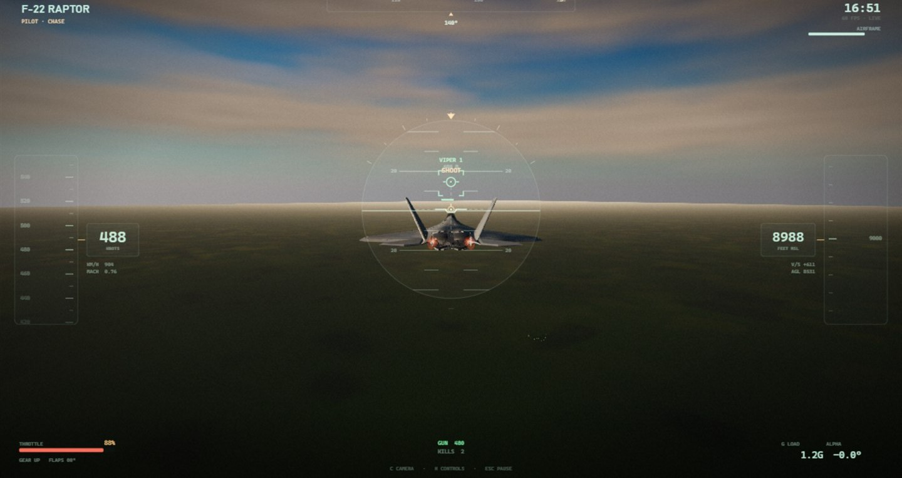
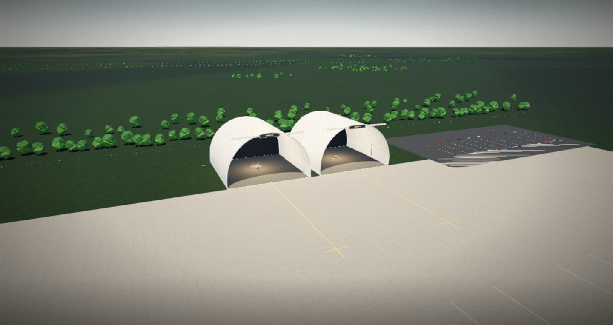

# STRATOS

**A browser flight simulator with a real flight model, Scott AFB rebuilt in code, and guns-only
dogfights against an AI Raptor — no install, no plugin, no joystick required.**



Open a tab, pick a jet, fly it out of the hangar and fight. The aircraft are rigid bodies with
mass, wing area and a lift curve that stalls; the world is a real airbase with a real runway
heading; and when you pull the trigger the rounds leave the barrel at M61 muzzle velocity, fall
under gravity and take time to arrive — so you have to lead.

> Status: playable development build. Three flyable airframes, the airbase, the HUD, the
> quality governor and a 1v1 guns engagement are in. See [docs/roadmap.md](docs/roadmap.md).

---

## Play it

**[jzewdu.github.io/Stratos](https://jzewdu.github.io/Stratos/)** — desktop Chrome, Edge or
Firefox with WebGL2. Nothing to install. (If that link 404s, the Pages build has not been
enabled yet: repository **Settings → Pages → Source: GitHub Actions**, then push.)

### Run it locally

```bash
npm install
npm run dev      # http://localhost:5173
npm run build    # production bundle into dist/
npm run preview  # serve the built bundle
```

`npm run stop` (or `stop-sim.cmd` on Windows) kills only the Vite process serving this project,
matched by port and command line, so unrelated Node apps are left alone.

---

## Controls

| Input | Action |
| --- | --- |
| `W` / `S` | Pitch (W = nose up) |
| `A` / `D` | Roll |
| `Q` / `E` | Rudder |
| `Shift` / `Ctrl` | Throttle up / down |
| `Space` | Wheel brakes |
| `V` or left mouse | Guns |
| `G` / `F` | Landing gear / flaps |
| `C` | Camera: chase · cockpit · cinema |
| `T` | Cycle time of day |
| `P` | Park (stopped on the hangar stand) |
| `L` / `M` | Landing light / sound |
| `H` / `Esc` / `R` | Manual / pause / restart |

On the runway: hold `Shift` for full power, keep straight with the rudder, ease the nose up at
the HUD's rotation call. Three control levels change how much of the aircraft is actually yours:

- **Cadet** — auto-level, stall protection, coordinated rudder. Sightseeing.
- **Pilot** — the wing is yours; stalls and energy are real; a light hand on the rudder.
- **Ace** — no assists, adverse yaw, hard turbulence, tighter G limit.

---

## What is in it

### Three airframes, flown properly

| Airframe | Character | What makes it different to fly |
| --- | --- | --- |
| **Cessna 182T Skylane** | 230 hp piston tourer | Slow, honest, fixed gear. Teaches energy management because you have none to spare. |
| **B-2A Spirit** | Flying-wing stealth bomber | Immense inertia, gentle roll, four engines. Like steering a building — because it is. |
| **F-22A Raptor** | Air-superiority fighter | Supercruise, afterburner, 9 g available. The dogfight jet. |

Each carries its published numbers into the simulation — top speed, ceiling, stall speed,
thrust, wing loading — and those numbers are *enforced by the aerodynamics*, not written on a
spec card. `tools/topspeed.mjs` flies each one to its limit and checks the achieved Mach and
true airspeed against the published envelope.

### A real airbase

**Scott Air Force Base, Illinois**: flat flood-plain farmland, hedgerows and woodlots, runway
**14/32**, and the twin white barrel-vault hangars. Aircraft start **inside hangar bay 01, on
their wheels, nose out**, so you can taxi out, line up and take off.

### Guns-only dogfights

A **1v1 guns engagement** against an AI-flown F-22 that flies the same physics you do. No
scripted splines, no rubber-banding: the bandit has energy, G limits, stall behaviour and an
engine that can be run out of airspeed. You get a fighter gunsight with a ballistic lead
pipper, a target tally with range and closure, ammo, health and a damage model that trails
smoke before it lets go. The combat layer is a list of combatants, not a scripted rival —
the shape is already there for several bandits at once.

### Graphics that scale to the machine

Four quality tiers, a GPU detector, and a runtime governor that trades internal resolution and
foliage for frame rate instead of dropping frames. On a discrete GPU you get GTAO contact
shadows, bloom, SMAA, 4x MSAA and 4096 shadows; on integrated graphics the same scene runs at a
reduced internal resolution with the expensive passes switched off. Nothing is fetched at
runtime: terrain, sky, asphalt, concrete, grass, markings, signage and the base itself are all
generated procedurally at load. The only external assets are the three airframe meshes.

---

## Gallery

| | |
| --- | --- |
|  |  |
| Guns engagement: ballistic pipper, target tally, range and closure | The barrel hangars, ramp and runway at Scott AFB |

---

## How it is put together

The simulation is a fixed-step loop with one module per job, so physics, ballistics and AI all
agree on time.

```
simulation clock  ──►  flight model  ──►  aircraft state
       │                    │
       ├──►  AI controller  │
       ├──►  gun ballistics ├──►  damage  ──►  effects, audio, HUD
       └──►  ground contact ┘
                                    │
                              render pipeline
                     (sky · terrain · scenery · post)
```

```
src/core/utils.js        noise, terrain height/normal, atmosphere
src/world/               sky, terrain, water, scenery, procedural textures
src/aircraft/            shared part builders, airframe configs, specs
src/flight/flight.js     flight dynamics and ground handling
src/combat/              guns, ballistics, damage, AI bandit
src/game/                input, cameras, particles, audio
src/ui/                  HUD canvas and hangar interface
src/main.js              orchestration and render loop
tools/                   headless verification scripts (physics + screenshots)
docs/                    design and engineering write-ups
```

- **Fixed 120 Hz simulation, decoupled rendering.** A slow frame produces more physics steps,
  not slower physics. Gun cadence, AI reactions and contact handling are frame-rate independent.
- **HUD at 30 Hz.** Indistinguishable behind a 3D scene at 60, half the canvas cost.
- **Quality is a runtime property.** The governor measures a rolling frame window and moves
  resolution, vegetation and post-processing up or down with hysteresis, so a hitch does not
  cause an oscillation.
- **Stack:** Three.js, Vite, Canvas 2D for the HUD, Web Audio for the entire soundscape
  (synthesised at runtime — no audio files). No physics engine, no game engine.

Deeper write-ups: [how it works](docs/how-it-works.md) ·
[flight model](docs/flight-model.md) · [rendering](docs/rendering.md) ·
[world](docs/world.md) · [aircraft](docs/aircraft.md) · [combat](docs/combat.md) ·
[performance](docs/performance.md) · [devlog](docs/devlog.md) ·
[roadmap](docs/roadmap.md) · [credits](docs/credits.md)

---

## Verification

```bash
node tools/topspeed.mjs      # published top speeds, per airframe
node tools/testtakeoff.mjs   # runway roll and liftoff
node tools/rolltest.mjs      # ground handling and climb-out
node tools/shoot.mjs out.png "window.game.startFlight()" 6000 1440 860
```

`tools/shoot.mjs` drives a running dev server in headless Chrome over CDP: it can execute
in-game actions, collect console errors and save screenshots.

---

## Licence — use it, credit it

MIT, plus one requirement: **if you reuse, fork or show this off, credit the original and link
back to [github.com/jzewdu/Stratos](https://github.com/jzewdu/Stratos).** See [LICENSE](LICENSE).

The three aircraft meshes are **not** covered by that licence — they are third-party works used
under their own terms:

- **F-22 Raptor** — NLM ([Sketchfab](https://sketchfab.com/NLM-Group)), CC BY 4.0
- **B-2 Spirit** — CloudHubOmniTeam ([Sketchfab](https://sketchfab.com/cloudhub)), CC BY 4.0
- **Cessna 182 Skylane** — VTX ([Sketchfab](https://sketchfab.com/VTX_car)), CC BY-NC-SA 4.0
  (non-commercial, share-alike — do not sell anything containing it)

Everything else — terrain, sky, textures, buildings, flight model, combat, effects, audio, HUD —
is original work. Full notes: [docs/credits.md](docs/credits.md).

STRATOS is an independent project. It is not affiliated with, endorsed by, or connected to the
United States Air Force, Lockheed Martin, Northrop Grumman, Textron or Boeing. Aircraft names
and designations are used descriptively.
